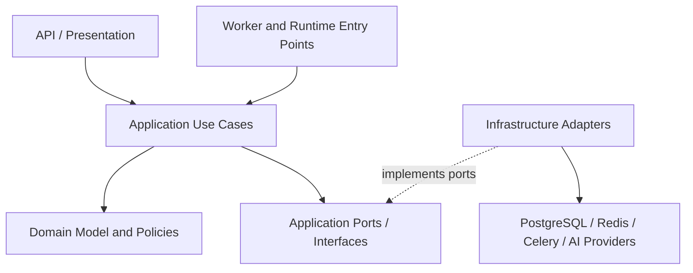

# Architecture Dependency Rules

> **Status:** Proposed dependency policy for the intended Django, Celery, PostgreSQL/pgvector, and React/TypeScript architecture. These rules describe the target design; verify actual imports, package references, and runtime wiring before claiming the codebase conforms.

## 1. Purpose

Dependency rules keep OpsPilot AI modular, testable, secure, and maintainable. They define which layers may reference other layers, where infrastructure and external providers enter the system, and how cross-module communication should work.

The primary rule is:

**Dependencies point toward domain policy and application use cases, not outward toward frameworks, databases, queues, or AI vendors.**

## 2. Logical layers

| Layer | Responsibility | May depend on |
|---|---|---|
| Domain | Business entities, value objects, invariants, domain policies, domain events | Standard library and stable domain abstractions only |
| Application | Use cases, orchestration, authorization decisions, transaction boundaries, ports/interfaces | Domain |
| Adapters / Infrastructure | Django ORM persistence, PostgreSQL, Redis, Celery, Channels, file storage, provider SDKs, external integrations | Application contracts and Domain |
| API / Presentation | DRF serializers, views, request/response mapping, authentication integration, REST and WebSocket entry points | Application interfaces; limited infrastructure wiring at the composition root |
| Workers / Runtime | Celery task entry points, scheduling, dependency construction, operational configuration | Application use cases and infrastructure adapters |
| Frontend | React UI, client-side state, API client, form validation and presentation logic | Published API contracts and frontend modules; never backend implementation internals |

This is a logical separation. It does not require every layer to be a separate Python package or deployment unit.

## 3. Dependency direction

The intended backend flow is:

The diagram is conceptual. Dependency injection, module boundaries, and framework configuration must be verified in code.

### Allowed dependencies

- Application use cases may invoke domain behavior and application-owned ports.
- Infrastructure adapters may implement ports defined by the application/domain boundary.
- API handlers may map transport input to application commands and map results to transport responses.
- Worker tasks may call application use cases; they should not reimplement business rules.
- Provider adapters may translate application-level AI requests into vendor-specific SDK calls and normalize responses.
- Frontend modules may use the documented HTTP/WebSocket contract, generated types where available, and shared frontend utilities.

### Forbidden or discouraged dependencies

- Domain code importing Django models, DRF serializers, Celery tasks, Redis clients, database sessions, or vendor SDKs.
- Application use cases importing concrete API views, serializers, React components, or provider-specific SDKs.
- Business rules duplicated in API handlers, Celery tasks, and frontend code.
- Infrastructure adapters becoming the owner of business policy rather than implementing defined contracts.
- Frontend code importing Python modules, ORM models, server settings, or internal database schemas.
- Circular imports between domain modules or between application modules.
- Direct cross-module database-table manipulation that bypasses the owning module's use cases and invariants.
- Hidden network, filesystem, or provider calls during module import.

## 4. Module ownership and cross-module communication

Each domain module should own its rules, application use cases, persistence mapping, and public interfaces for its capability. Candidate modules include incidents, events, services, knowledge, investigations, reporting, audit, and integrations; the actual module list must follow the implementation.

For cross-module workflows:

1. Prefer an explicit application interface or use case owned by the module responsible for the operation.
2. Use domain events or integration events when a meaningful event must be consumed asynchronously.
3. Define event schemas, versions, identifiers, and compatibility behavior explicitly.
4. Avoid exposing internal ORM models as a cross-module API.
5. Avoid circular calls; if two modules require each other, identify a higher-level orchestrator or clarify ownership.
6. Keep audit records and tenant authorization requirements intact across module boundaries.

Use asynchronous messaging for work that benefits from independent execution, retries, or decoupling—not as a substitute for every ordinary function call.

## 5. Ports and adapters

Define application-owned protocols or abstract interfaces for dependencies whose implementation may vary, for example:

- Incident and event repositories.
- Knowledge-document retrieval.
- Embedding generation.
- AI investigation/generation.
- External event-source clients.
- Clock, identifier, and file-storage abstractions where deterministic testing or provider substitution warrants them.

Keep interfaces narrow and shaped around use cases. Avoid generic abstractions that merely mirror a vendor SDK. Adapters must normalize provider errors, enforce timeouts, validate responses, and avoid leaking provider-specific types into the domain.

Do not add an interface for every class automatically; introduce a port where it creates a meaningful test seam, architectural boundary, or substitution point.

## 6. Django-specific rules

- Treat Django ORM models as persistence-layer representations unless deliberately designed and tested as domain models.
- Keep request parsing and DRF serialization separate from domain invariants.
- Place transaction boundaries in explicit application orchestration or a well-defined persistence adapter; do not keep transactions open during LLM or external network calls.
- Use migrations for schema changes. Never mutate production schema as a side effect of importing application modules.
- Keep Django settings and environment parsing at the runtime/composition boundary.
- Avoid importing task modules from domain code merely to enqueue work. Use an application-owned dispatch port or an explicit integration boundary.
- Validate permissions and tenant scope on every access path, including background tasks.
- Do not let serializer validation become the sole enforcement point for important business invariants.

## 7. Celery and asynchronous work

- Celery task functions are thin entry points: validate task input, establish execution context, call an application use case, and report status.
- Pass stable identifiers and small serializable payloads rather than ORM instances, request objects, credentials, or large document contents.
- Re-fetch and authorize resources inside the task; queued arguments are not proof of authorization.
- Make task handlers idempotent or use durable deduplication and state-transition controls.
- Define retryable versus permanent failures, bounded retries, timeouts, and sanitized observability.
- Avoid importing application business logic into task registration in ways that create cycles. Register tasks at the runtime boundary.
- Do not assume enqueueing and a database transaction are atomic. Evaluate a transactional outbox or another explicit reliable-dispatch strategy if lost dispatch would violate business guarantees.

## 8. AI and retrieval boundaries

- Keep provider SDKs, model names, prompt transport, and vendor error details inside provider adapters.
- Treat prompts, retrieved documents, model outputs, and external events as untrusted input.
- Validate structured outputs against application-owned schemas and verify citations against authorized retrieved evidence.
- Enforce tenant and document permissions before evidence reaches a model or user; similarity ranking is not authorization.
- Keep the distinction between hypothesis and confirmed root cause in domain/application state.
- Do not allow AI adapters to execute production remediation directly. Any remediation workflow requires explicit policy, authorization, auditability, and human approval.
- Version prompts, model/provider configuration, and evaluation fixtures when needed for reproducibility.

## 9. Frontend/backend contract

- The React application communicates with the backend through documented REST endpoints and authorized WebSocket events.
- Keep transport DTOs separate from backend ORM entities and internal domain classes.
- Generate API schemas/types from implemented endpoints when practical; do not claim a proposed contract is generated or current until verified.
- Treat all client input as untrusted. Server-side validation and authorization remain authoritative.
- WebSocket notifications should carry minimal identifiers/version metadata; fetch authoritative resource state through authorized APIs.
- Keep secrets and provider credentials exclusively on the server.
- Do not couple UI components directly to storage or infrastructure implementation details.

## 10. Dependency injection and composition root

Construct concrete adapters at a small number of explicit runtime boundaries, such as Django application startup/configuration and worker setup. Business modules should receive dependencies through function parameters, constructors, or a documented application service factory.

- Keep environment variables and secret loading at the outer boundary.
- Avoid a global service locator or mutable singleton registry for ordinary application dependencies.
- Avoid expensive I/O during import or application initialization.
- Make test configurations able to replace repositories, provider clients, clocks, and dispatchers without contacting real external services.
- Ensure web and worker processes use compatible configuration and schema versions during deployment.

## 11. Testing implications

| Test level | Primary focus | Dependency strategy |
|---|---|---|
| Domain unit tests | Invariants, policies, state transitions | No database, network, broker, or model provider |
| Application unit tests | Use-case orchestration and failure paths | Fake or mock application ports |
| Adapter integration tests | ORM mappings, queries, Redis/Celery integration, provider protocol mapping | Controlled test services and fixtures |
| API tests | Authentication, authorization, validation, tenant isolation, response contracts | Django/DRF test client and isolated persistence |
| Worker tests | Serialization, retries, idempotency, task status and recovery | Eager mode only for narrow unit tests; integration tests for real broker behavior where needed |
| Frontend tests | Component behavior, API states, accessibility | Mocked HTTP/WebSocket boundaries |
| End-to-end tests | Cross-layer user workflows and critical authorization guarantees | Dedicated test environment with deterministic dependencies |

Mocks do not prove adapter compatibility or production configuration. Include integration tests for the critical persistence, queue, and authorization boundaries.

## 12. Enforcement

Adopt lightweight, automated checks where the repository structure supports them:

- Import-linter or an equivalent Python import-boundary check.
- Ruff or another configured linter for import hygiene and static checks.
- Type checking for application ports and adapter implementations where feasible.
- Frontend linting and TypeScript type checking.
- Tests that prove tenant isolation and prevent unauthorized cross-module access.
- CI checks that fail on dependency-rule violations rather than silently allowing new cycles.

First inspect existing tooling and configuration. Add checks incrementally and align them with actual package paths; do not introduce a configuration that references nonexistent modules.

## 13. Exceptions and change control

An exception must state the affected boundary, why the rule cannot reasonably be followed, its risks, and a removal or review condition. Record material architectural exceptions in an ADR under [Architecture Decision Records](decisions/README.md).

## 14. Conformance checklist

- [ ] Domain code imports no framework, database, queue, or provider SDK.
- [ ] Application use cases depend on domain policy and application-owned ports.
- [ ] Infrastructure adapters implement ports without owning application policy.
- [ ] API and Celery entry points delegate to shared application use cases.
- [ ] Cross-module communication uses explicit contracts and avoids cycles.
- [ ] Tenant authorization is enforced for API, task, cache, retrieval, and WebSocket paths.
- [ ] Provider-specific types and errors do not leak into core business logic.
- [ ] Frontend code depends only on public API contracts.
- [ ] Dependency boundaries and critical integration paths are checked in CI.
- [ ] This document has been reconciled with the actual source tree and import graph.

## Related documentation

- [System architecture](system-architecture.md)
- [Deployment topology](deployment.md)
- [Scalability and performance strategy](scalability.md)
- [Architecture Decision Records](decisions/README.md)

Until source code is available for inspection, this document is a target policy, not a conformance report.
