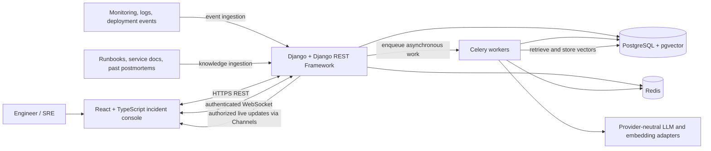
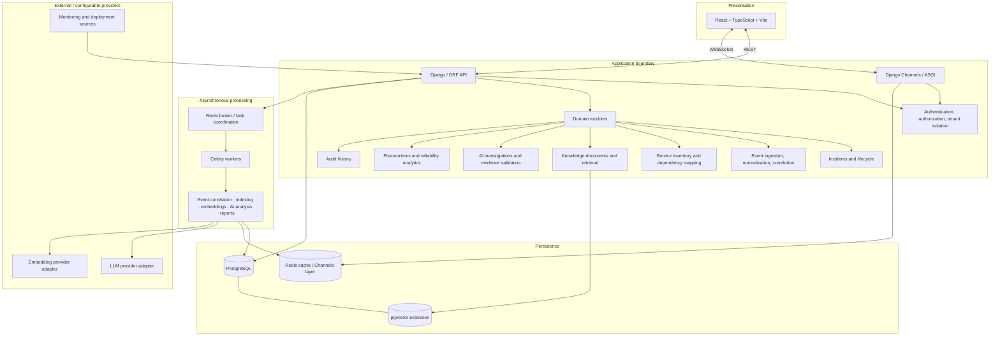
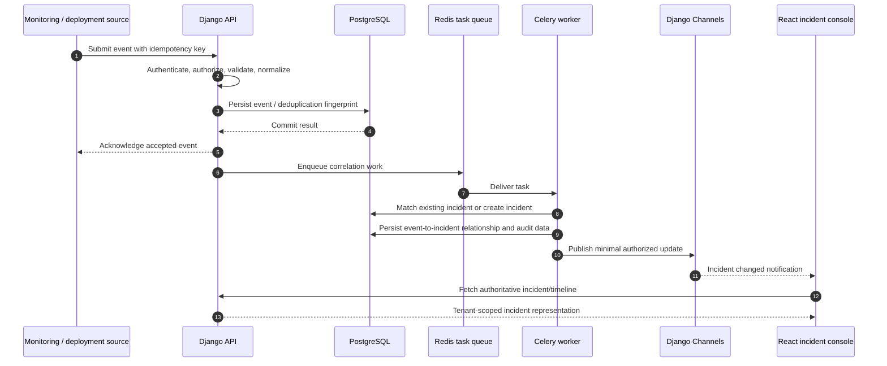
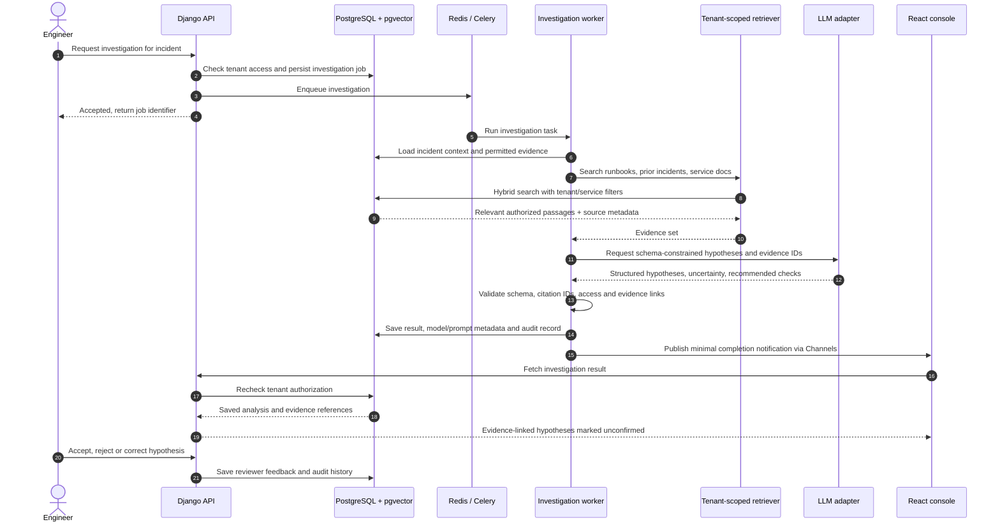
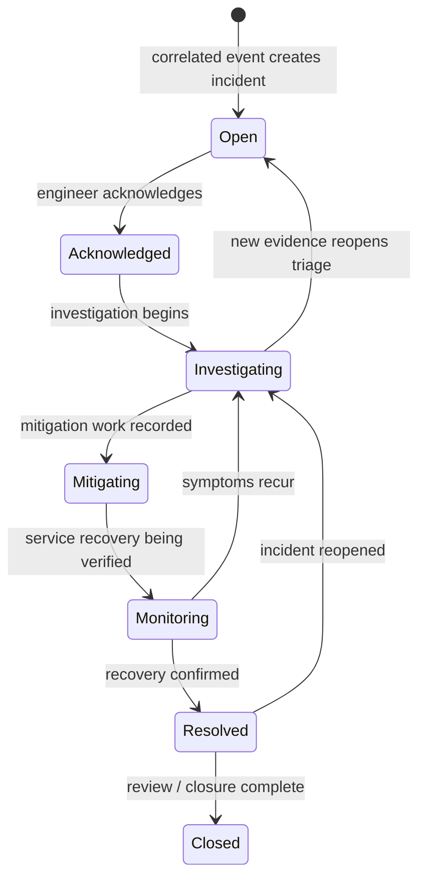

# OpsPilot AI — Architecture as Code

> **Documentation status:** derived from the attached project README/specification, not verified against application source code. The repository was empty when this documentation was prepared. Treat the diagrams, entity model, API routes, and deployment topology below as the intended design baseline until implementation is pushed and reconciled.

## System context

## Container and logical architecture

This is a **modular monolith**, not a microservice topology. Domain modules are logical boundaries within Django; Celery workers are independently scalable processes.

## Event ingestion and correlation

**Reliability note:** the specification recommends idempotency and reliable database-to-queue delivery (preferably a transactional outbox). The diagram shows the logical workflow; it does not assert that an outbox or particular queue-delivery guarantee is already implemented.

## Evidence-grounded AI investigation (RAG)

Rules: retrieved evidence must be authorized for the requesting tenant; citations must resolve to actual stored evidence; vector similarity is not a probability of correctness; hypotheses remain unconfirmed until human review; production remediation is not automatically executed.

## Incident lifecycle (conceptual)

These state names are a proposed lifecycle derived from the workflow described in the specification. They must be reconciled with the actual Django model choices and transition rules once source code is available.

## Documentation map

- [Architecture decisions](decisions/README.md)
- [Conceptual ERD](../database/erd.md)
- [Proposed API contract](../api/contract.md)
- [Deployment topology](deployment.md)

## Source of truth and maintenance

1. Update diagrams in the same pull request as relevant domain, API, schema, task, or deployment changes.
2. Generate the production OpenAPI schema from DRF endpoints when available; do not let the proposed API document become an independent competing contract.
3. Replace the conceptual ERD with a schema derived from Django models and migrations.
4. Verify deployment nodes against the checked-in Docker Compose and CI files.
5. Keep proposed elements labeled until confirmed by code and tests.
