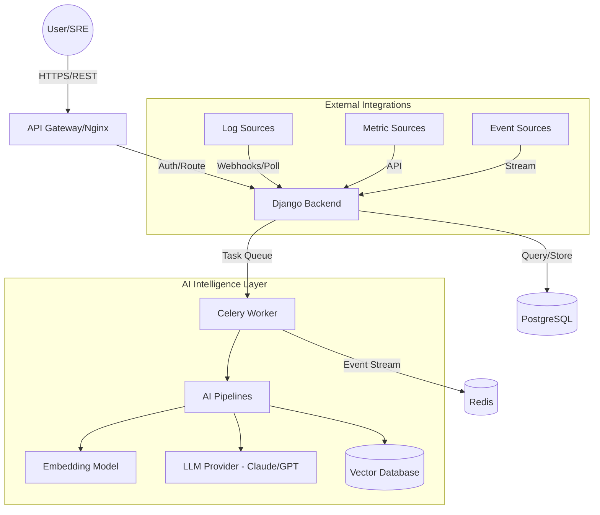

# System Architecture

## High-Level Overview
OpsPilot AI is an AI-driven operational intelligence platform designed to correlate events, investigate incidents, and provide actionable insights using LLMs.

