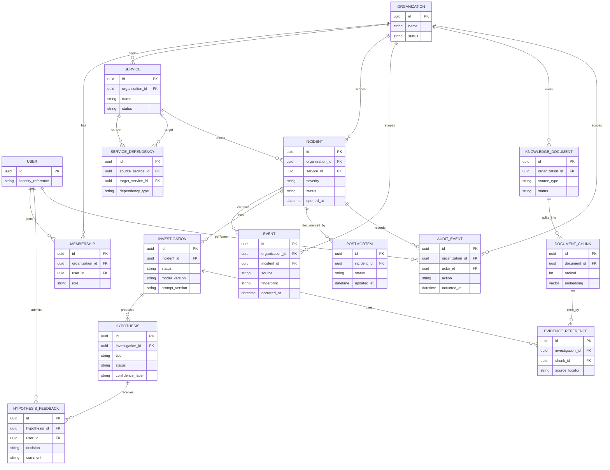

# OpsPilot AI — Conceptual Entity-Relationship Diagram

> **Conceptual proposal, not a schema extraction.** The repository had no application source or migrations when this was authored. Entity and relationship names below are inferred from the attached specification and must be reconciled with actual Django models before being treated as the implemented schema.

## ERD

## Design constraints to verify during implementation

- Every tenant-owned record and query must enforce organization/tenant scope, including Celery tasks and vector retrieval.
- Event ingestion should support an idempotency key or deterministic fingerprint to prevent duplicate processing.
- Evidence references must resolve to stored source material that the current user is authorized to access.
- Hypotheses are not confirmed root causes; reviewer feedback should be recorded.
- The exact identity model may use Django's configured user model rather than a literal `USER` table.
- Vector type, extension, dimensions, indexes, deletion behavior, and document versioning must come from actual migrations.
- Relationship cardinalities are a conceptual baseline; validate them against actual business rules and model constraints.
