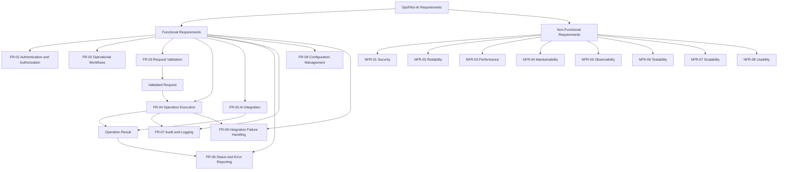

# OpsPilot-AI — Requirements Specification

## 1. Purpose

This document defines a baseline of functional and non-functional requirements for OpsPilot-AI. Validate these requirements against the implemented application before treating them as an approved specification.

## 2. Stakeholders and Actors

- **Administrator:** Manages supported system configuration and access policies.
- **Operator:** Uses supported operational workflows.
- **Developer:** Maintains and diagnoses application behavior.
- **AI Service:** Provides configured AI processing when a workflow requires it.
- **External Service:** Exchanges data with configured integrations.

## 3. Functional Requirements

| ID | Requirement | Priority |
|---|---|---|
| FR-01 | The system shall authenticate users and enforce access permissions. | High |
| FR-02 | The system shall provide an interface for supported operational workflows. | High |
| FR-03 | The system shall validate incoming requests before processing them. | High |
| FR-04 | The system shall execute supported operations through the appropriate application services. | High |
| FR-05 | The system shall integrate with configured AI capabilities where a workflow requires them. | High |
| FR-06 | The system shall report operation status and relevant errors. | High |
| FR-07 | The system shall record relevant application events for auditing and troubleshooting. | High |
| FR-08 | The system shall allow authorized administrators to manage supported configuration. | Medium |
| FR-09 | The system shall handle integration failures using the configured error-handling and retry policies. | High |

## 4. Non-Functional Requirements

| ID | Requirement | Verification |
|---|---|---|
| NFR-01 | Security | Verify authentication, authorization, input validation, and secret management. |
| NFR-02 | Reliability | Test expected failure scenarios and ensure internal exceptions are not exposed to users. |
| NFR-03 | Performance | Measure response times against agreed service-level targets. |
| NFR-04 | Maintainability | Keep responsibilities separated into appropriate application layers. |
| NFR-05 | Observability | Provide structured logs and actionable diagnostic information without logging secrets. |
| NFR-06 | Testability | Provide automated tests for core business rules and API behavior. |
| NFR-07 | Scalability | Evaluate growth against the selected architecture and infrastructure. |
| NFR-08 | Usability | Provide clear validation messages, operation status, and actionable failure feedback. |

## 5. Requirements Relationship Diagram

## 6. Acceptance Criteria

A requirement is verified when:
1. Its expected behavior and acceptance criteria are documented.
2. An automated test or repeatable verification procedure exists.
3. Relevant authorization, validation, and failure scenarios are tested.
4. The result can be traced to a requirement ID.
5. Documentation reflects the actual implementation.

## 7. Traceability

Maintain this relationship for each approved requirement:

`Requirement ID → Use Case → Implementation → Test → Verification Result`

Mark requirements that are not implemented as planned, not completed.
