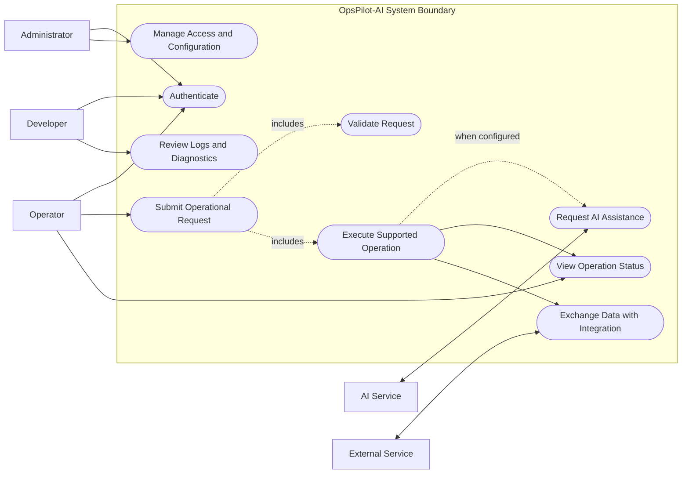

# OpsPilot-AI — Use-Case Specification

## 1. Purpose

This document describes the high-level actors and use cases for OpsPilot-AI. Reconcile the baseline with the actual authentication model, API endpoints, domain services, and configured integrations before treating it as a definitive system specification.

## 2. Actors

| Actor | Responsibility |
|---|---|
| Administrator | Manages authorized system settings and access policies. |
| Operator | Initiates and monitors supported operational workflows. |
| Developer | Maintains and diagnoses application behavior. |
| AI Service | Provides configured AI processing when required by a workflow. |
| External Service | Exchanges data with supported third-party integrations. |

## 3. UML Use-Case Diagram

Mermaid does not provide a native UML use-case diagram syntax. This flowchart represents actors, the system boundary, and use cases using Mermaid-compatible syntax.

## 4. Use-Case Descriptions

### UC-01: Authenticate User

**Primary actor:** User

**Preconditions:**
- The application is available.
- The user has a supported authentication method.

**Main flow:**
1. The user submits credentials or uses the configured identity provider.
2. The application validates the authentication request.
3. The application establishes an authenticated session or issues an appropriate token.
4. Access is granted according to the configured authorization rules.

**Alternative flow:** Invalid credentials or an authentication failure produce a controlled error response.

**Postcondition:** The user is authenticated, or access is denied.

### UC-02: Manage Access and Configuration

**Primary actor:** Administrator

**Preconditions:** The administrator is authenticated and authorized.

**Main flow:**
1. The administrator opens the relevant management interface.
2. The application verifies permissions.
3. The administrator updates a supported setting or access policy.
4. The application validates and persists the change.
5. The outcome is reported and audited where applicable.

**Alternative flow:** Invalid settings or insufficient permissions prevent the change.

**Postcondition:** The valid change is applied, or the operation is rejected without an unauthorized modification.

### UC-03: Submit Operational Request

**Primary actor:** Operator

**Preconditions:** The operator is authenticated and the requested workflow is supported.

**Main flow:**
1. The operator submits an operational request.
2. The application validates the input and permissions.
3. The appropriate application service processes the request.
4. Required integrations or AI capabilities are invoked when applicable.
5. The application returns a result or operation identifier.
6. The operator views the operation status and outcome.

**Alternative flows:**
- Invalid input is rejected with actionable validation feedback.
- An unavailable dependency produces a controlled failure or a retry where supported.
- An AI service failure is handled according to the configured fallback policy.

**Postcondition:** The operation outcome is reported and relevant diagnostics are available.

### UC-04: Request AI Assistance

**Primary actor:** Operator  
**Supporting actor:** AI Service

**Preconditions:**
- The workflow supports AI assistance.
- An AI provider is configured and accessible.

**Main flow:**
1. The operator initiates an AI-assisted workflow.
2. The application prepares validated, permitted input.
3. The configured AI service processes the request.
4. The application validates and presents the returned result.

**Alternative flow:** A timeout, provider error, or invalid result is handled without exposing secrets or internal diagnostic details.

**Postcondition:** The result or a controlled failure status is returned.

### UC-05: Review Logs and Diagnostics

**Primary actor:** Developer

**Preconditions:** The developer has the required diagnostic permissions.

**Main flow:**
1. The developer accesses the available diagnostics.
2. The application retrieves authorized log or operation information.
3. The developer investigates errors and operation outcomes.
4. The developer uses the evidence to support troubleshooting.

**Postcondition:** Relevant diagnostic evidence is available without disclosing protected information.

## 5. Use-Case Relationships

- Authentication and authorization protect use cases that require a verified identity.
- Request validation occurs before an operation is executed.
- AI assistance is conditional on the workflow and configured provider.
- External integrations are used only when required by the selected operation.
- Diagnostics respect authorization and sensitive-data handling policies.

## 6. Verification Checklist

- [ ] Each actor maps to a real role or external system.
- [ ] Each use case maps to an implemented endpoint, service, or supported workflow.
- [ ] Authorization rules are verified with positive and negative tests.
- [ ] AI and integration failures have defined handling behavior.
- [ ] Use cases link to relevant functional requirement IDs.
- [ ] Diagrams render successfully in GitHub Markdown.
