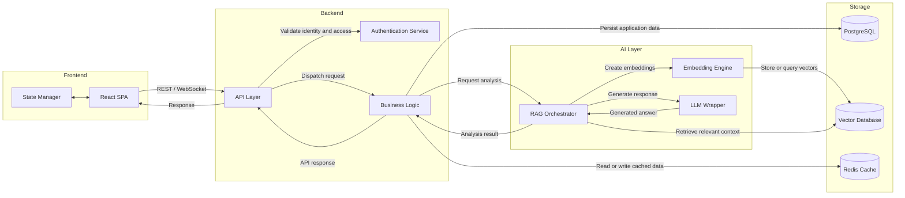

# Component Diagram

Structural view of the OpsPilot AI system, showing the frontend, backend services, AI/RAG pipeline, and persistence infrastructure.

## Diagram

## Component responsibilities

| Component | Responsibility |
| --- | --- |
| React SPA | Presents the user interface and sends requests to the backend. |
| State Manager | Maintains client-side UI and request state. |
| API Layer | Exposes application endpoints and coordinates incoming requests. |
| Authentication Service | Validates identity and authorization for protected operations. |
| Business Logic | Applies application rules and coordinates persistence and AI analysis. |
| RAG Orchestrator | Coordinates retrieval-augmented generation and combines retrieved context with the user request. |
| Embedding Engine | Converts text into vector representations for semantic retrieval. |
| LLM Wrapper | Encapsulates calls to the configured language model. |
| PostgreSQL | Stores relational application data. |
| Vector Database | Stores and retrieves embeddings and relevant context. |
| Redis Cache | Provides low-latency access to frequently used or temporary data. |

## Request flow

1. The React SPA sends a request to the API layer over REST or WebSocket, as appropriate.
2. The API layer validates access through the authentication service and dispatches the request to business logic.
3. For AI-assisted requests, business logic invokes the RAG orchestrator.
4. The RAG orchestrator uses the embedding engine and vector database to retrieve relevant context, then passes the request and context to the LLM wrapper.
5. Business logic persists application data in PostgreSQL and uses Redis where caching is appropriate.
6. The result returns through the API layer to the frontend.

> **Implementation note:** This diagram documents the intended logical architecture. Confirm the actual adapters, storage products, and communication protocols against the implementation as the codebase evolves.
